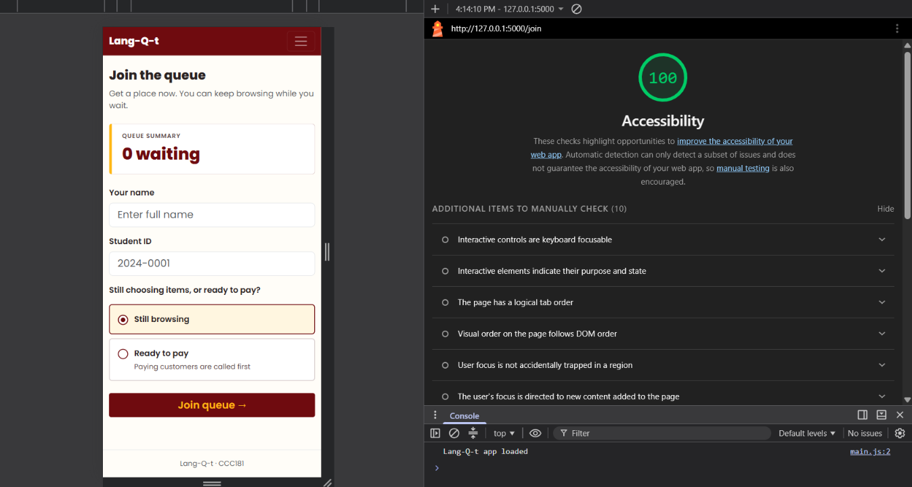
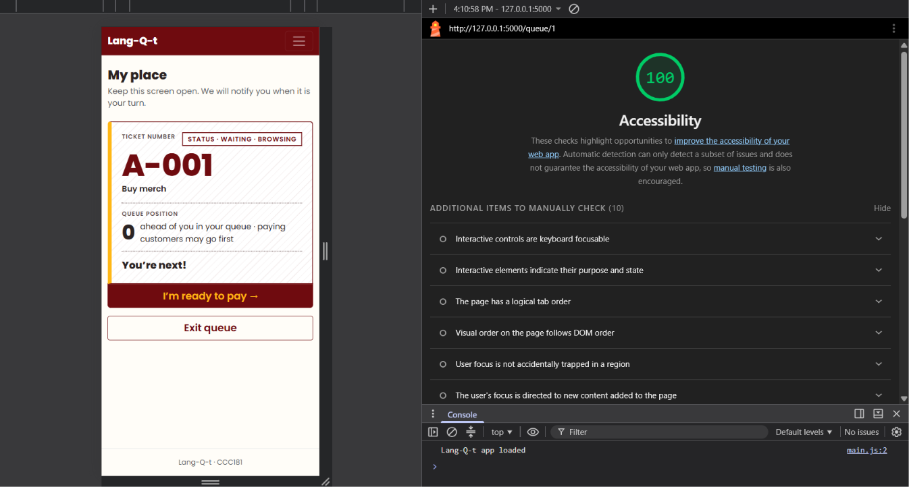
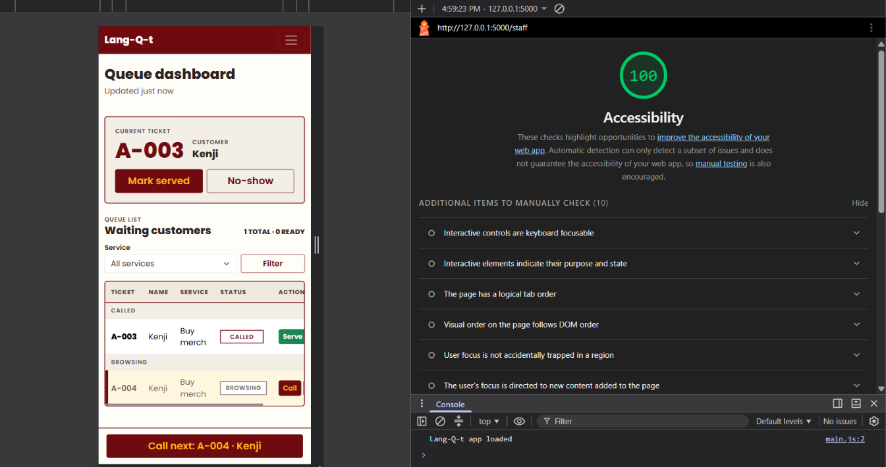

## Lighthouse

| | |
| --- | --- |
| **Join Page** |  |
| **My Place Page** |  |
| **Staff Dashboard Page** |  |

## Keyboard only

| | |
| --- | --- |
| **Issue** | **Fix** |
| When I use tab to navigate the site, a bar with a button that says "Skip to main content" appears which just adds to the time it takes to navigate using keyboard only. | I simply removed the `<a class="visually-hidden-focusable" href="#main">Skip to main content</a>` line from base.html. |

## Manual checklist

| Check | Join | My place | Staff |
| --- | --- | --- | --- |
| Every input has a visible label |✅| N/A |✅|
| Error messages say what to do, in text |✅| N/A | N/A |
| Status is shown in words, not only color |✅|✅|❌ (Fix: The next ticket to be called was marked only by a highlighted row. I added a “Next” text tag beside its ticket number, so the status is clear without relying on colour)|
| Text and buttons are readable at 375 px with no sideways page scroll |✅|✅|✅|
| Buttons are at least about 44 × 44 px on a phone |✅|✅|❌ (Fix: The Call, Serve and No-show buttons, plus the Filter button and Service select, were about 31 to 38 px tall. I set a 44 px minimum height and width on screens under 768 px so they are easy to tap)|
| Page has one `<h1>` and headings in order |✅|✅|✅|
| `<html lang="en">` (or your language) is set |✅|✅|✅|