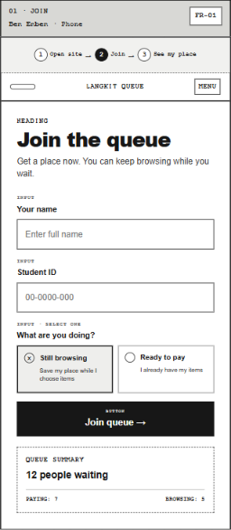
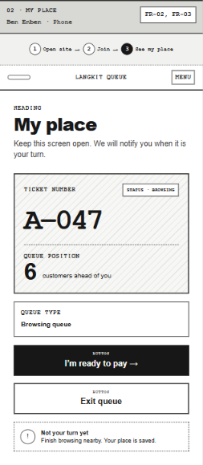
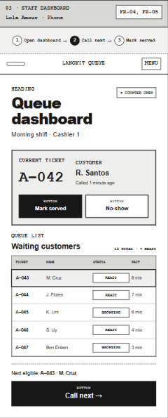
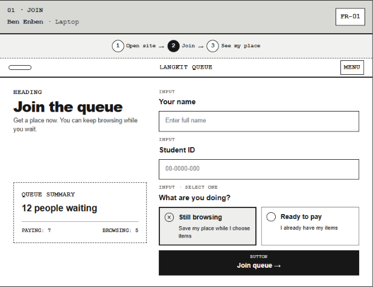
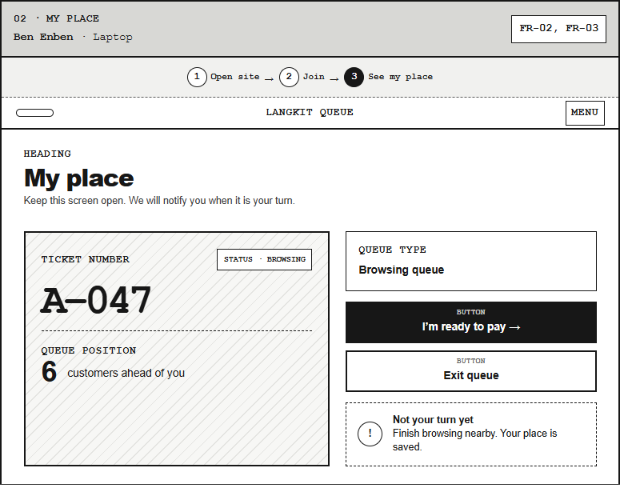
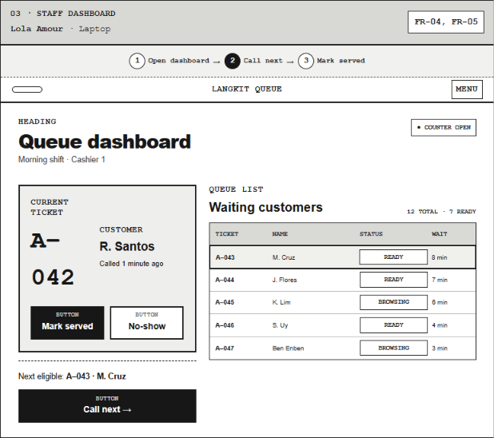

## Join Page (Phone)

> 

| | |
| --- | --- |
| **Works well** | The choice between Still browsing and Ready to pay is the entry point to the dual queue. The large heading and full-width button also suit Ben’s poor eyesight. |
| **Problem** | The queue summary sits below the Join button, so Ben commits before he sees how busy it is. The labels, hints and summary are also too small for him |
| **Change** | I’ll move the summary above the form as one large line (e.g. “12 waiting”) and drop the paying/browsing split on the phone to keep it minimal. I’ll also raise the field label and option text one size |
| |

## My PLace Page (Phone)

> 

| | |
| --- | --- |
| **Works well** | The ticket number, status badge and position are large and grouped in one card. Ben sees the most important thing first. |
| **Problem** | “6 customers ahead of you” sugests a fixed order, but paying customers can jump ahead of a browsing customer. The “Not your turn yet” note is also tiny and at the bottom. "Exit queue" sits right under “I’m ready to pay” with similar styling, so a mis-tap may cause him to lose his place. |
| **Change** | I’ll reword the position to “6 ahead · paying customers may go first” and move a larger status line into the ticket card. Exit queue becomes a quieter button with a confirm step (“Leave the queue? You’ll lose your ticket A-047”). |
| |

## Staff Dashboard Page (Phone)

> 

| | |
| --- | --- |
| **Works well** | The current ticket (A-042, R. Santos) and its actions, Mark served and No-show, are at the top. Lola can finish the current transaction without scrolling. |
| **Problem** | Call next is the most frequent action, but it sits at the bottom under a dense five-column table. “Next eligible” is a small separate line, so Lola has to scroll and remember who is next. The table also risks overwhelming her. |
| **Change** | I’ll make a sticky bottom bar that reads “Call next: A-043 · M. Cruz” and remove the separate “Next eligible” line. I’ll cut the phone table to ticket, name and status, and make No-show a secondary button. |
| |

## Join Page (Laptop)

> 

| | |
| --- | --- |
| **Works well** | The queue summary sits beside the form, so Ben sees how busy it is while filling it in. The selected option has a heavy border and a filled icon, so the choice is clear. |
| **Problem** | “What are you doing?” is vague, and nothing tells Ben that Ready to pay gets called first. The text is also small for a laptop screen. |
| **Change** | I’ll reword the question as “Still choosing items, or ready to pay?” and add one short line under Ready to pay: “Paying customers are called first”. The summary stays in the side card in larger type. |
| |

## My PLace Page (Laptop)

> 

| | |
| --- | --- |
| **Works well** | The ticket card is the clear focal point, with the large A-047, the status badge and the position grouped together. The heading also tells Ben to keep the screen open and that he’ll be notified. |
| **Problem** | Status appears twice, in the badge and in the Queue type box, which adds clutter. “Not your turn yet” is small and parked at the bottom right, away from the ticket. Nothing hints that his place can change when paying customers arrive. |
| **Change** | I’ll merge the Queue type box into the badge and put one large status line in the ticket: “Not your turn yet · 6 ahead”. The side column will hold only the two buttons, and Exit queue gets the same confirm step as on the phone. |
| |

## Staff Dashboard Page (Laptop)

> 

| | |
| --- | --- |
| **Works well** | Lola sees the current ticket and the full waiting list side by side. The highlighted next-eligible row (A-043) and the READY and BROWSING tags make it quick to scan. |
| **Problem** | Call next is at the bottom of the left column, far from the highlighted row it acts on, and Mark served and No-show are more prominent than it. The ticket also wraps (“A–” / “042”), and the mixed list hides the dual queue. |
| **Change** | I’ll widen the card so A-042 stays on one line and put “Call next: A-043” at the top as the primary button. No-show becomes secondary. I’ll group the table into “Ready to pay” rows first and “Browsing” rows below in quieter styling. |
| |