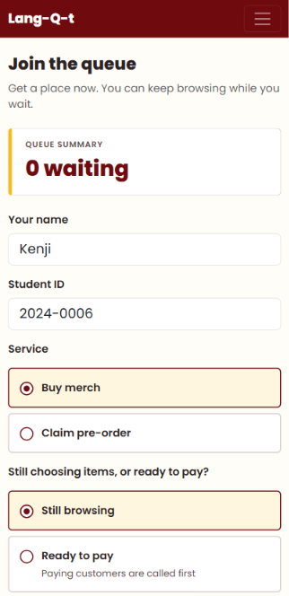
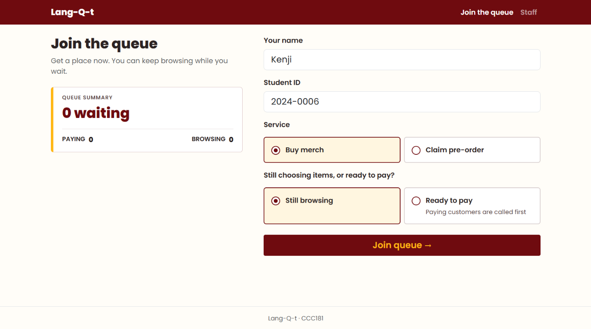
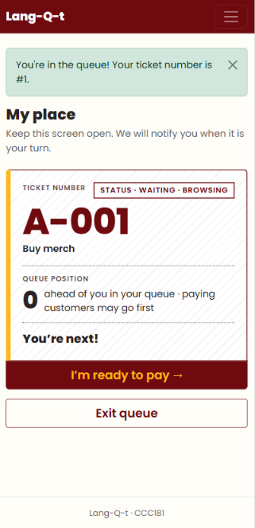
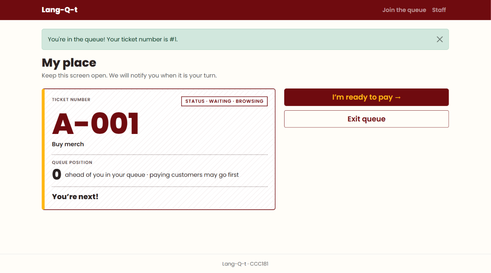
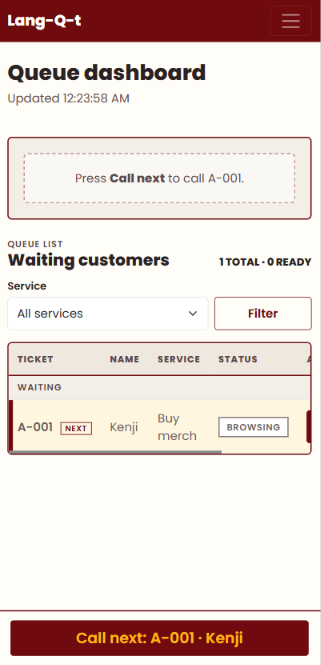
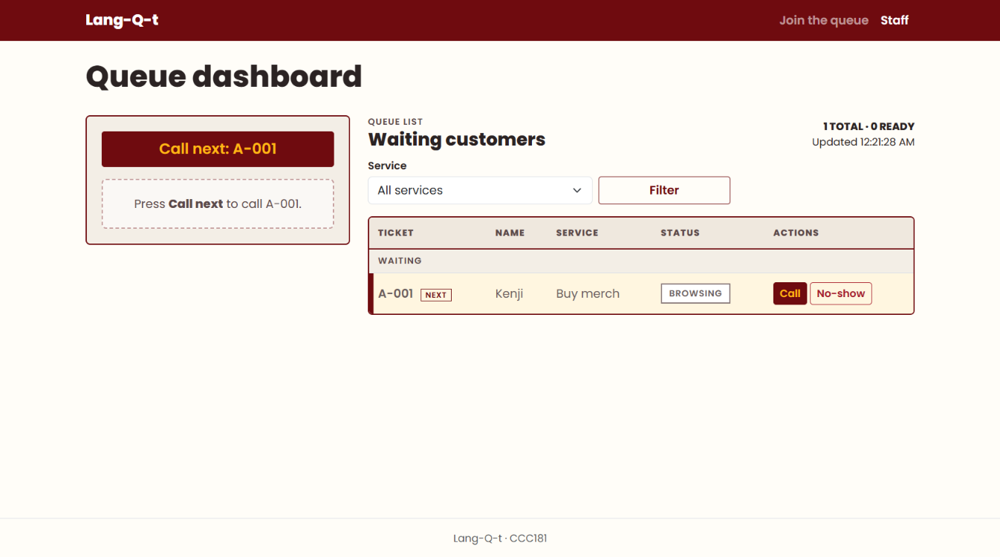

# Lang-Q-t: Week 3 Report

## Title details

| | |
| --- | --- |
| **App name** | Lang-Q-t |
| **Setting** | Langkit University Shop (virtual queue for buying merch and claiming pre-orders) |
| **Full name** | Kenneth Jerome C. Gloria |
| **Student ID** | 2024-0006 |
| **Section** | CS3B |
| **Date** | October 31, 2026 |
| **Pull request** | https://github.com/Kenji7676/ccc181/pull/2 |

## Personas

Full personas: [docs/week3/personas.md](personas.md)

**Ben Enben (customer, uses a phone)**
- Quote: "Daghan unta koy gusto paliton sa Langkit ba pero aside sa nagkabusy na jud mi sa kadaghan sa amo exams kay naa pajud to time na nagdasok ang mga first years sa Langkit kay namalit ug PE uniform." *(interview)*
- Top tasks: join the queue (FR-01), see my ticket and place in line (FR-02), leave the queue (FR-03)

**Lola Amour (shop staff, uses a laptop)**
- Quote: "Maulawon jud ko na tao pero required man sa amo na mag duty dira sa Langkit maong paningkamutan ra pud nako pero naa jud usahay na daghan kaayog customer tas mangulba nako. Ma overwhelm nako nya di na nuon ko ka keep track sa mga order ug bayad." *(interview)*
- Top tasks: see who is waiting, in order (FR-04), call the next customer and mark them served or no-show (FR-05)

## Screens

**Join the queue.** Used by Ben Enben to get a ticket quickly from his phone; covers FR-01.

| Phone | Laptop |
| --- | --- |
|  |  |

**My place.** Used by Ben Enben to check his ticket number, status and position while he keeps browsing; covers FR-02 and FR-03.

| Phone | Laptop |
| --- | --- |
|  |  |

**Staff dashboard.** Used by Lola Amour to call customers in order and close out tickets; covers FR-04 and FR-05.

| Phone | Laptop |
| --- | --- |
|  |  |

## Design decisions

1. **The ticket number is the largest thing on My place.** A waiting customer glances at their phone and needs one answer: "What is my number, and how far am I?" The wireframe puts the number first, the status in a boxed tag beside it, and the position as a sentence right below, so Ben never has to hunt for it.

2. **Customers who are ready to pay are called first, and the interface says so.** The Join page asks "Still choosing items, or ready to pay?" only for Buy merch, because Claim pre-order customers have nothing to browse. The dashboard groups tickets into Called, Ready to pay and Waiting, and My place explains "paying customers may go first". This keeps the rule visible to both people, so a browsing customer is not surprised when someone behind them is called.

3. **"Call next" is always one tap away for staff.** On the laptop it is the top button of the dashboard and names the next ticket ("Call next: A-043"). On a phone it is a sticky bar fixed to the bottom of the screen. Lola should be able to move down the queue without searching for the right row, and the large button avoids mis-taps on a busy counter. *(Persona: Lola Amour; Staff dashboard wireframe; FR-05.)*

## Self-review

- **Problem:** On the phone Join page, the queue summary sat below the Join button, so Ben committed before seeing how busy it was, and the labels and hints were too small for his eyesight (Ben rule 3). **Principle:** Visibility of system status. **Change:** I moved the summary above the form as one large line ("12 waiting"), dropped the paying/browsing split on the phone, and raised the label and option text a size.
- **Problem:** On the laptop Join page, "What are you doing?" was vague, and nothing told Ben that Ready to pay is called first (Ben rules 1 and 2). **Principle:** Match between the system and the real world. **Change:** I reworded it as "Still choosing items, or ready to pay?" and added "Paying customers are called first" under Ready to pay.
- **Problem:** On My place, "6 customers ahead of you" implied a fixed order, even though paying customers can jump ahead, and the "Not your turn yet" note was tiny and at the bottom. **Principle:** Visibility of system status. **Change:** The position now reads "6 ahead of you in your queue · paying customers may go first", and the status badge and one large status line sit inside the ticket card.
- **Problem:** On My place, Exit queue sat right under "I'm ready to pay" with similar styling, so a mis-tap could lose Ben his place. **Principle:** Error prevention. **Change:** Exit queue is now a quieter outline button that opens a "Leave the queue? You'll lose A-047" confirm step.
- **Problem:** On the staff dashboard, Call next, the most frequent action, was buried at the bottom of the screen and far from the row it acts on (Lola rule 2). **Principle:** Flexibility and efficiency of use. **Change:** Call next is the top button on the laptop and a sticky bottom bar on the phone that names the next customer. No-show became a secondary button.
- **Problem:** The staff list mixed ready and browsing customers, and the ticket number wrapped across two lines, which added clutter for Lola (Lola rule 1). **Principle:** Aesthetic and minimalist design. **Change:** The table now groups Ready to pay above Waiting with quieter styling for the lower group, and the current ticket card is wide enough that A-042 stays on one line.

## Accessibility

| Page | Lighthouse accessibility score |
| --- | --- |
| Join | 100 |
| My place | 100 |
| Staff dashboard | 100 |

Full checklist: [docs/week3/accessibility.md](accessibility.md)

**Most important issue fixed:** On the staff dashboard, the row buttons (Call, Serve, No-show) were small `btn-sm` buttons about 31 px tall, which is hard to tap on a phone. I set a 44 px minimum height and width on screens under 768 px. I also added a text "Next" tag beside the ticket that will be called next, because it was previously marked only by a highlighted row colour.

## Usability test

Participant: Xue Zizi, a BTLEd Home economics student that matches Ben Enben as a Langkit customer with a very hectic class schedule. Tasks were given without help unless noted.

| **Task** | Did they finish it? | About how long it took | Where they hesitated, what they said, and anything that surprised you | Which of your persona's "Because …, my interface must …" rules held up, and which did not |
| --- | --- | --- | --- | --- |
| "You just arrived. Get in line for [one of your services]." | Yes, without help | ~1 minute | Finished quickly with no hesitation. The form has only a name, a Student ID and a service choice, so there was little to get stuck on. | **Held:** *Ben rule 3 ("my interface must go for a more minimalist approach with large font sizes").* The short form with large inputs let her finish unaided. |
| "How many people are ahead of you? What is your number?" | Yes, without help | A few seconds | Found both immediately. The ticket number is the largest text on the page and the position is written as a sentence. | **Held:** *Ben rule 3.* The ticket number is the largest text on the page. |
| "Pretend you are the staff member. Call the next person and mark them as served." | Yes, with help | ~4 minutes | She could not easily find the Staff link in the navigation bar, because her attention was on the queue information. Once on the dashboard, the task itself went smoothly. | **Did not hold:** *Lola rule 2 ("my interface must run smoothly to significantly lessen the queueing time").* Staff lost most of the four minutes before reaching their tools. |

**The improvement.** The staff member could not find the dashboard without help, so I made the way in obvious: a "Working at the shop? Open the staff dashboard" button on the home page, and the navbar link renamed "Staff dashboard" with a gold outline.

| Before | After |
| --- | --- |
|  |  |
|  |  |

I did not re-test this change.

Full notes: [docs/week3/usability-test.md](usability-test.md)

## Reflection

**Hardest this week:** The hardest part, aside from simultaneously completing the CCC181 and CSC181 tasks, was modifying the given code snippets to include the double queueing system needed for my app.

**What I will change in Week 4 when the data moves to a database:**
- Replace the in-memory `TICKETS` list with a `tickets` table, so tickets survive a server restart. The ticket number will come from an auto-incrementing key instead of `max(...) + 1`.
- Move `SERVICES` into its own table and link each ticket to it with a foreign key, so adding a service no longer needs a code change.
- Store the Student ID as its own column and keep the format check on the server.
- Keep the "ahead of you" and paying-first ordering as a database query, so My place and the dashboard both read from the same source and always agree.
- Keep the status values (`waiting`, `called`, `served`, `no-show`) as a constrained column, so a typo cannot create an invalid state.
- Show a friendly “Ticket not found” page instead of a bare 404, now that tickets will persist.
- Reject a Student ID that already holds an active ticket, with a clear error on the Join form.
- Show how long each customer has waited on the dashboard, using a timestamp column, to help with Lola’s rule about smooth service.

## AI Declaration

Select one option:

- [ ] No generative AI tools were used in preparing this submission.
- [x] One generative AI tools were used. Details are provided below.

| Tool | Purpose and sections assisted |
|---|---|
| Figma AI | Helping create wireframes | 
| Claude (Anthropic) | Reviewing code snippets | Checking if there are any ideas overlooked |
| Claude (Anthropic) | Articulating ideas into words | 