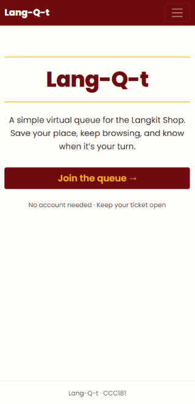
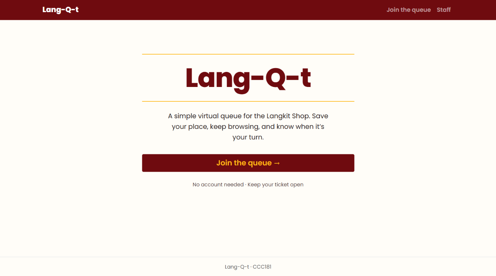
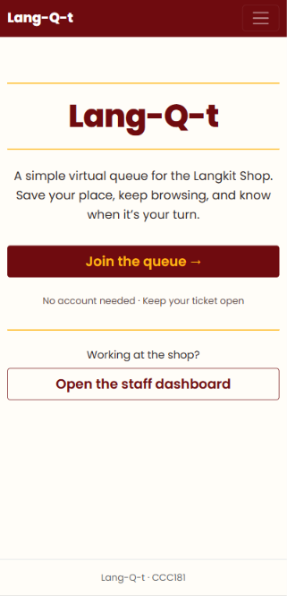
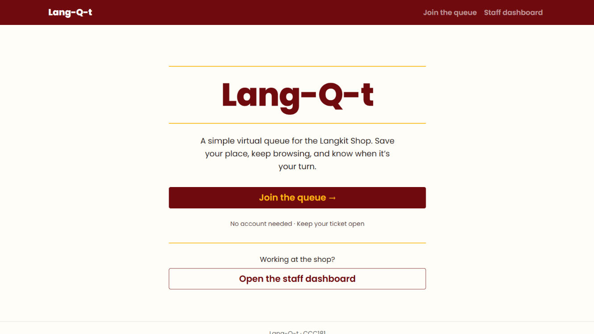

## Test with a real user (asynchronous)

| Task | Did they finish it? | About how long it took | Where they hesitated, what they said, and anything that surprised you | Which of your persona's "Because …, my interface must …" rules held up, and which did not |
| --- | --- | --- | --- | --- |
| "You just arrived. Get in line for [one of your services]." | Yes, without help | ~1 minute | Finished quickly with no hesitation. The form has only a name, a Student ID and a service choice, so there was little to get stuck on. | **Held:** *Ben rule 3 (“my interface must go for a more minimalist approach with large font sizes”).* The form has only a name, a Student ID and a service choice, with large inputs, and the participant finished unaided in about a minute.  **Held:** *Ben rule 1 (dual queue).* If they chose Buy merch, the form asks whether they were still browsing or ready to pay. They can also queue differently when claiming pre-order.|
| "How many people are ahead of you? What is your number?" | Yes, without help | a few seconds | Found both immediately. The ticket number is the largest text on the page and the position is written as a sentence. | **Held:** *Ben rule 3 (clear user interface).* The ticket number is the largest text on the page, and the participant read both their number and their place in seconds. |
| "Pretend you are the staff member. Call the next person and mark them as served." | Yes, with help | ~4 minutes | She wasn't easily able to locate the staff button in the navigation bar since most of her attention was focused on the queue information. Once on the dashboard, the task itself went smoothly. | **Did not hold:** *Lola rule 2 (“my interface must run smoothly”).* The participant could not find the Staff link in the navigation bar and needed help, so staff lost most of the four minutes before reaching their tools. |

##  Make one improvement

**The problem.** In the staff task, my participant could not find the way to the staff dashboard without help, and the task took about 4 minutes. She told me she was focused on the queue information on the page, so the small "Staff" link in the navigation bar did not stand out. This was the most serious problem I found: it blocked an entire role from its main task, while both customer tasks were finished unaided in about a minute or less.

**What I changed.**
1. Added a "Working at the shop? Open the staff dashboard" button to the home page, below the main Join button.
2. Renamed the navbar link from "Staff" to "Staff dashboard."

**Before.** The only route was a small, plain "Staff" link in the navigation bar.

**After.** The home page has a full-width staff button, and the navbar link is outlined and says "Staff dashboard".

