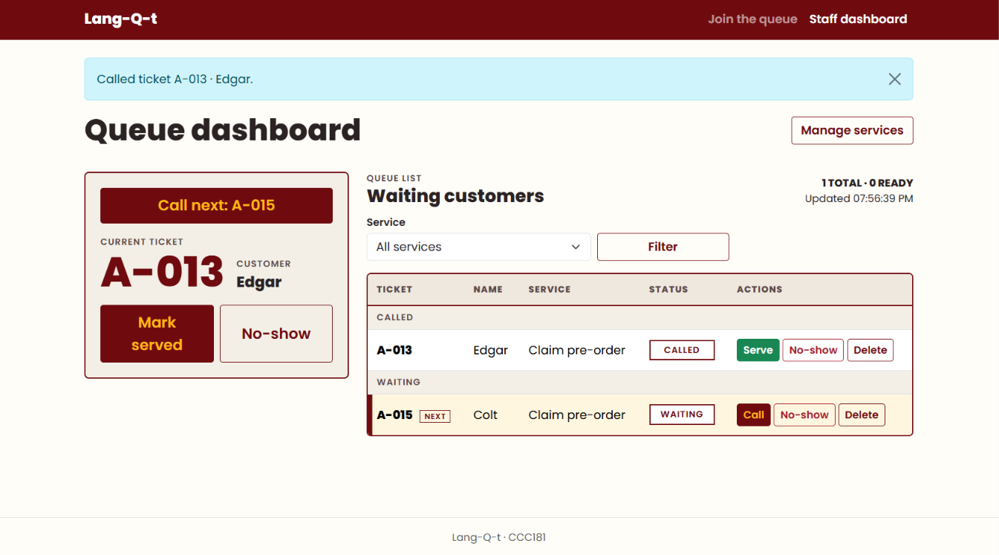
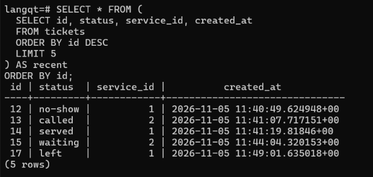
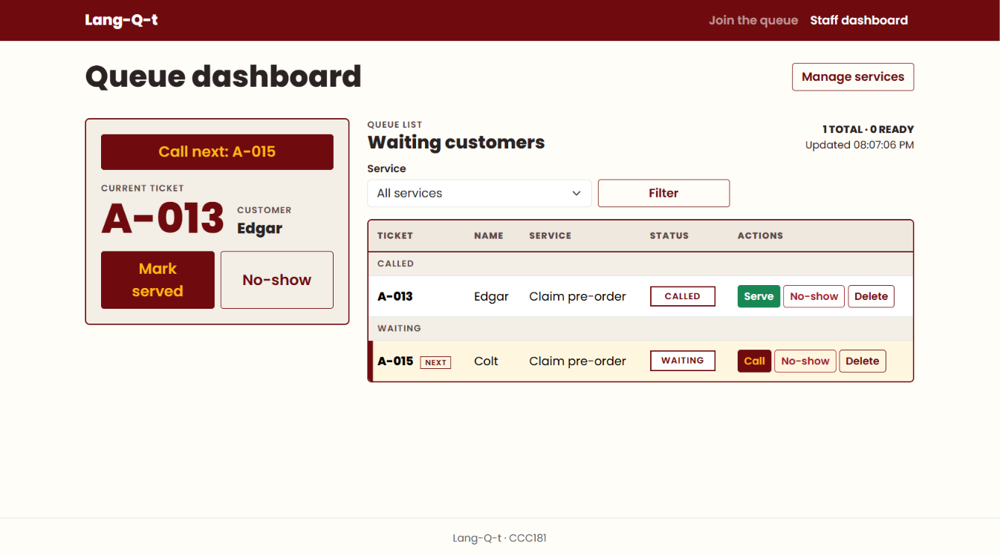
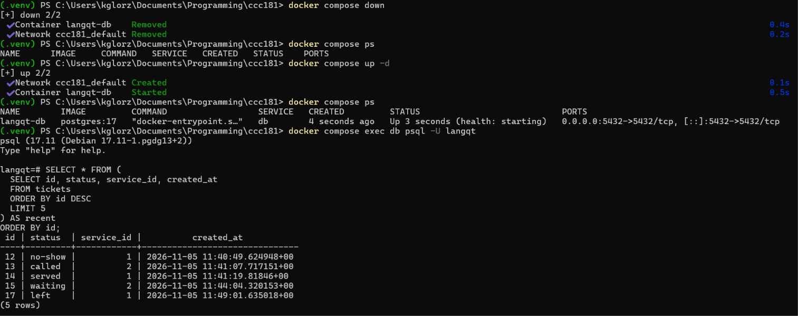
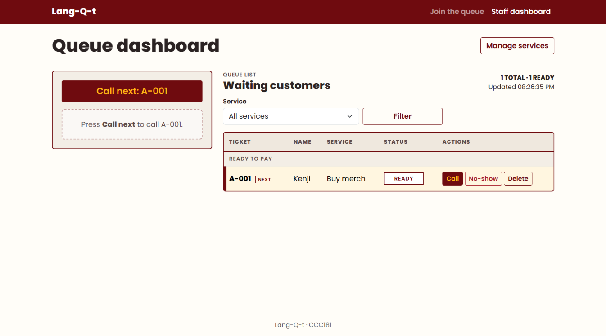

# Proof of Persistence

## Restart test

1. I created five different tickets on separate windows with a sixth window opened for the staff dashboard. I called one customer and left it called, served one customer, marked one as no-show, let one customer leave on their own, and left one customer still waiting to be called. That covers the five statuses: `called`, `served`, `no-show`, `left`, and `waiting`.

2. Before the restart, the staff dashboard lists the two active tickets: A-013 (Edgar, Claim pre-order) is called and shown in the current ticket panel, and A-015 (Colt, Claim pre-order) is waiting and marked Next. The counter reads "1 total · 0 ready". The query below lists the last five tickets, and the three finished ones (12 no-show, 14 served, 17 left) do not appear on the dashboard because it shows only waiting and called tickets. The stored `created_at` times are visible, so after the restart I can check that they are unchanged.

    `docker compose exec db psql -U langqt -P pager=off -c "SELECT * FROM (SELECT id, status, service_id, created_at FROM tickets ORDER BY id DESC LIMIT 5) AS recent ORDER BY id;"`




3. I stopped Flask with Ctrl+C, ran `docker compose down`, and ran `docker compose ps`, which listed nothing running.

4. I ran `docker compose up -d`, waited until `docker compose ps` said healthy, and started Flask again with `flask --app app run --debug`.

5. After the restart, the app's dashboard had no changes aside from the notification pop-up disappearing which is normal, and the query results were also the same.




**Result:** All five tickets came back with the same ids, statuses, services and join times (tickets 12, 13, 14, 15 and 17, with the same `created_at` values as before). The dashboard again showed A-013 as called and A-015 as waiting. The data lives in the named volume `pgdata`, and `docker compose down` removes only the container, not the volume.

## Rebuild from scratch

I ran the following commands as per the assignment instruction:

```
docker compose down -v
docker compose up -d
flask --app app db upgrade
flask --app app seed
```

**Result:** `docker compose down -v` removed the container and the `pgdata` volume, so every ticket was deleted, which is expected. After `docker compose up -d`, the new database was empty. `flask --app app db upgrade` rebuilt the `users`, `services` and `tickets` tables from the two committed migrations (the first creates the tables, the second adds `tickets.served_at`), and `flask --app app seed` added the two starting services, Buy merch and Claim pre-order. The app worked again with no manual SQL: the Join page listed both services, the staff dashboard showed the empty queue, and a new ticket started again at A-001. This shows that anyone who clones the repository can rebuild the database from the migrations and the seed command.

