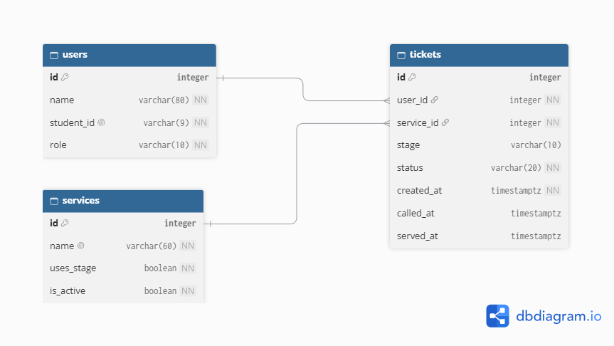
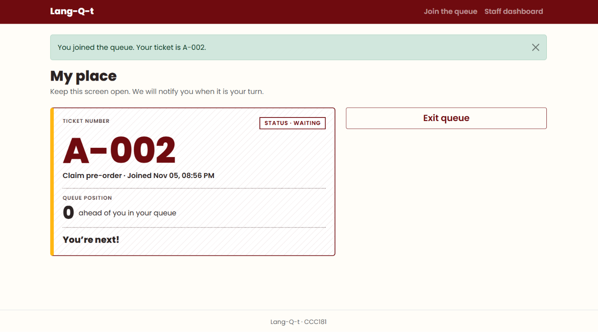
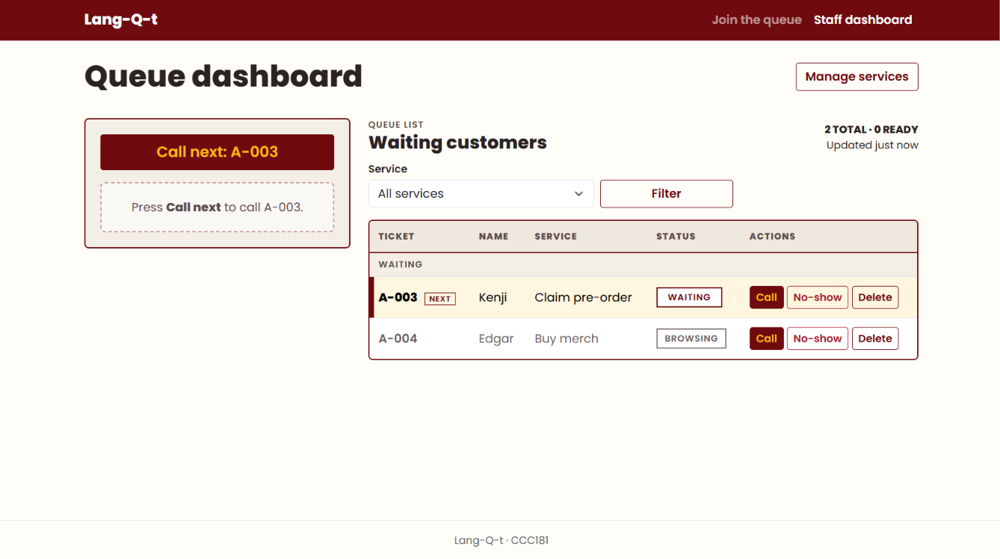
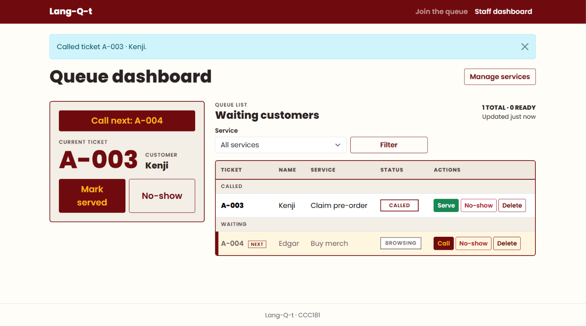
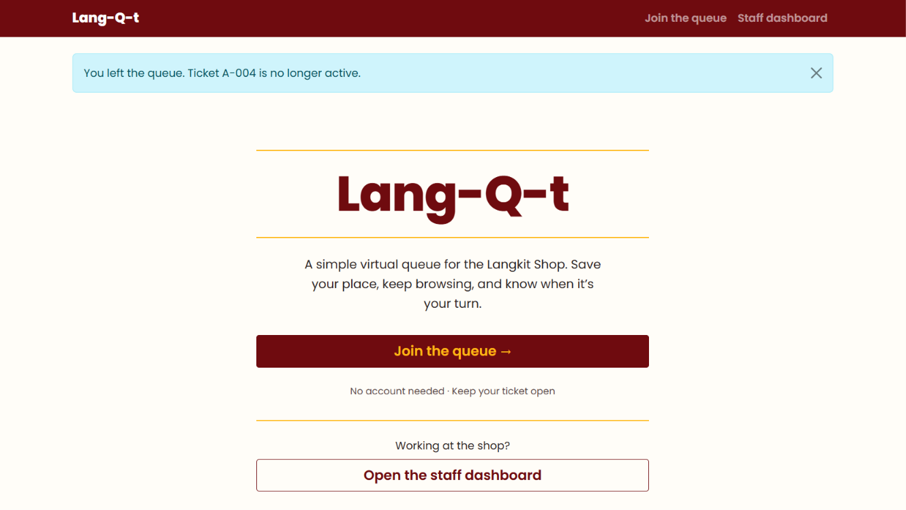
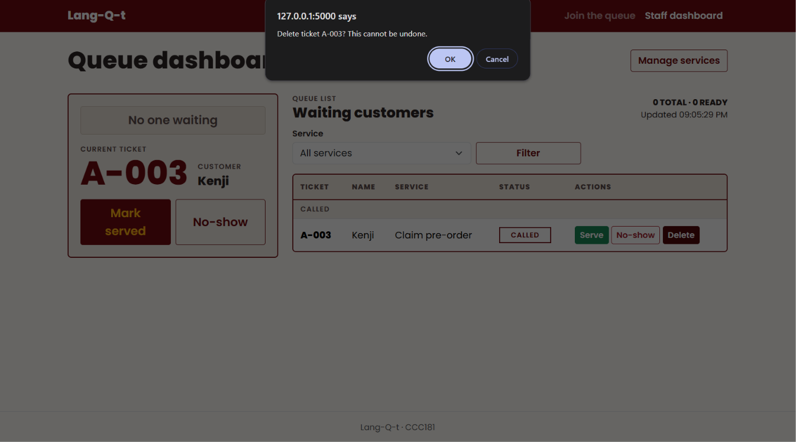
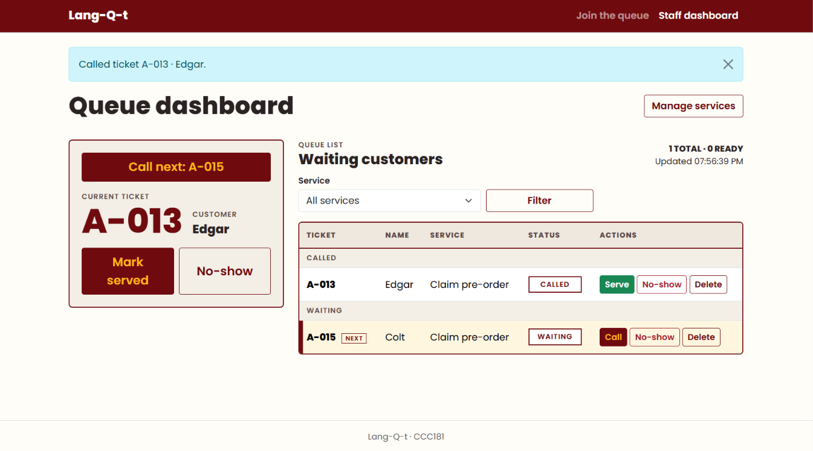
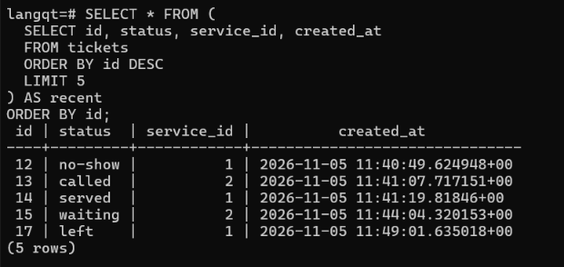
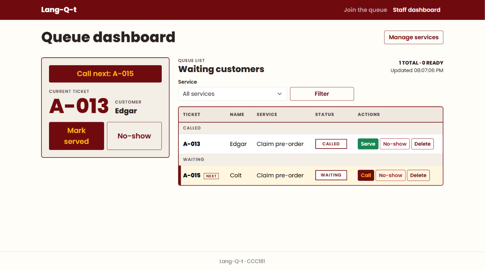
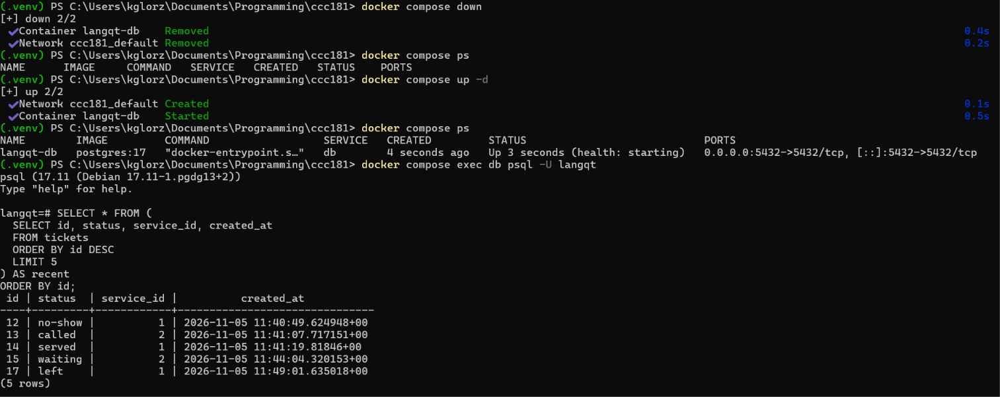

# Lang-Q-t: Week 4 Report

## Title details

| | |
| --- | --- |
| **App name** | Lang-Q-t |
| **Setting** | Langkit University Shop (virtual queue for buying merch and claiming pre-orders) |
| **Full name** | Kenneth Jerome C. Gloria |
| **Student ID** | 2024-0006 |
| **Section** | CS3B |
| **Date** | November 5, 2026 |
| **Pull request** | https://github.com/Kenji7676/ccc181/pull/5 |

## Requirements

I wrote **12 functional requirements** (FR-01 to FR-12) and **[11] non-functional requirements** (NFR-01 to NFR-[11]). Four functional requirements are marked ★ because they are specific to the Langkit shop: FR-06 (paying customers are called first), FR-07 (a browsing customer can switch to paying), FR-08 (Student ID format), and FR-12 (one active ticket per service). 

The full list is in [docs/requirements.md](../requirements.md).

**MVP:** FR-01 to FR-08, and NFR-01, NFR-02, NFR-07 and NFR-08. These are the Must rows. Together they let a customer join the right queue, see their place and leave, and let staff see the queue and call, serve or no-show customers, with paying customers always called first. This is the smallest version that still solves the shop's problem, because it removes the crowded, unordered line and keeps the ready-to-pay rule that makes Langkit's queue different from a plain first-come list. Managing services (FR-09), the time limit (FR-11) and the one-ticket rule (FR-12) make the shop easier to run, but the queue still works without them.

**What my setting's reviewer said, and what I changed.** John, an Engineering student, reviewed my requirements:

- *They suggested a time limit on how long a person can wait before being treated as a no-show, with advance notice.* I added **FR-11**: a called customer has 3 minutes to reach the counter, sees a warning when 1 minute is left, and is marked no-show automatically when time runs out.
- *They said NFR-04 and NFR-05 were not integral to the app.* I lowered both from Must to Should and removed them from the MVP since I think they are still needed.
- *They named FR-01, FR-02 and FR-09 as their three most important requirements.* I marked them as the top priorities. I changed FR-09 to Must since it is a feature explicitly asked for by the activity.

## ERD



- One user holds many tickets.
- One service has many tickets.
- Each ticket belongs to exactly one user and exactly one service.

Both relationships are one-to-many, with the foreign key on the "many" side (`tickets.user_id` and `tickets.service_id`). There is no many-to-many relationship, so no join table is needed. Both foreign keys use `ON DELETE RESTRICT`, so a user or service that has tickets cannot be deleted and the history stays available for reports.

Full schema, column by column: [docs/week4/schema.md](schema.md)

## Schema

Output of `\d` for each table (`docker compose exec db psql -U langqt -c "\d users"`, and the same for `services` and `tickets`):

**Table:** Users
```users
   Column   |         Type          | Collation | Nullable |              Default
------------+-----------------------+-----------+----------+-----------------------------------
 id         | integer               |           | not null | nextval('users_id_seq'::regclass)
 name       | character varying(80) |           | not null |
 student_id | character varying(9)  |           | not null |
 role       | character varying(10) |           | not null | 'customer'::character varying
Indexes:
    "users_pkey" PRIMARY KEY, btree (id)
    "users_student_id_key" UNIQUE CONSTRAINT, btree (student_id)
Check constraints:
    "ck_users_name_not_blank" CHECK (length(TRIM(BOTH FROM name)) > 0)
    "ck_users_role" CHECK (role::text = ANY (ARRAY['customer'::character varying, 'staff'::character varying]::text[]))
    "ck_users_student_id_format" CHECK (student_id::text ~ '^[0-9]{4}-[0-9]{4}$'::text)
Referenced by:
    TABLE "tickets" CONSTRAINT "tickets_user_id_fkey" FOREIGN KEY (user_id) REFERENCES users(id) ON DELETE RESTRICT
```

**Table:** Services
```services
   Column   |         Type          | Collation | Nullable |               Default
------------+-----------------------+-----------+----------+--------------------------------------
 id         | integer               |           | not null | nextval('services_id_seq'::regclass)
 name       | character varying(60) |           | not null |
 uses_stage | boolean               |           | not null | false
 is_active  | boolean               |           | not null | true
Indexes:
    "services_pkey" PRIMARY KEY, btree (id)
    "services_name_key" UNIQUE CONSTRAINT, btree (name)
Check constraints:
    "ck_services_name_not_blank" CHECK (length(TRIM(BOTH FROM name)) > 0)
Referenced by:
    TABLE "tickets" CONSTRAINT "tickets_service_id_fkey" FOREIGN KEY (service_id) REFERENCES services(id) ON DELETE RESTRICT
```

**Table:** Tickets
```tickets
   Column   |           Type           | Collation | Nullable |               Default
------------+--------------------------+-----------+----------+-------------------------------------
 id         | integer                  |           | not null | nextval('tickets_id_seq'::regclass)
 user_id    | integer                  |           | not null |
 service_id | integer                  |           | not null |
 stage      | character varying(10)    |           |          |
 status     | character varying(20)    |           | not null | 'waiting'::character varying
 created_at | timestamp with time zone |           | not null | now()
 called_at  | timestamp with time zone |           |          |
 served_at  | timestamp with time zone |           |          |
Indexes:
    "tickets_pkey" PRIMARY KEY, btree (id)
    "one_active_ticket_per_service" UNIQUE, btree (user_id, service_id) WHERE status::text = ANY (ARRAY['waiting'::character varying, 'called'::character varying]::text[])
Check constraints:
    "ck_tickets_called_after_created" CHECK (called_at IS NULL OR called_at >= created_at)
    "ck_tickets_served_after_created" CHECK (served_at IS NULL OR served_at >= created_at)
    "ck_tickets_stage" CHECK (stage::text = ANY (ARRAY['browsing'::character varying, 'paying'::character varying]::text[]))
    "ck_tickets_status" CHECK (status::text = ANY (ARRAY['waiting'::character varying, 'called'::character varying, 'served'::character varying, 'no-show'::character varying, 'left'::character varying]::text[]))
Foreign-key constraints:
    "tickets_service_id_fkey" FOREIGN KEY (service_id) REFERENCES services(id) ON DELETE RESTRICT
    "tickets_user_id_fkey" FOREIGN KEY (user_id) REFERENCES users(id) ON DELETE RESTRICT
```

## Design decisions

1. **`stage` (browsing or paying) is on `tickets`, not on `users`.** A student may be still browsing on one visit and ready to pay on the next, and can switch during a single visit with "I'm ready to pay". Because it describes one visit, it changes on the ticket row. This supports FR-06 and FR-07 and Ben's rules about the dual queue.

2. **`uses_stage` is a column on `services`, not a hard-coded check for "Buy merch" in the code.** Only some services ask "still browsing or ready to pay?", and Claim pre-order does not. Storing the flag on the service means staff can add a new service that asks the question, or one that does not, without a code change (FR-09). It also keeps `tickets.stage` empty for services that do not use it.

3. **Services are switched off with `is_active`, not deleted, and the foreign keys use `RESTRICT`.** Lola needs old tickets for reports, so a service that has tickets cannot be deleted, and a retired service is hidden from the Join page instead (FR-09). A hard delete is only possible for a service with no tickets, which the Manage services page enforces with a clear message.

## Self-review

Full notes: [docs/week4/schema-review.md](schema-review.md)

| | |
| --- | --- |
| **Works well** | The schema stores facts and computes results. `tickets` keeps only `created_at`, `called_at` and `served_at`, with no stored position, count or waiting time, so nothing has to be rewritten when someone joins or leaves, and My place and the staff dashboard can never disagree about who is next. |
| **Problem** | A double tap, or the same student submitting from two tabs, could create two active tickets for the same service. `users.student_id` is UNIQUE, but that only prevents duplicate people, not duplicate tickets. |
| **Change** | I added a partial unique index on `tickets(user_id, service_id)` where status is `waiting` or `called`, and a new requirement, FR-12. |

| | |
| --- | --- |
| **Works well** | Every fact lives in one place. A person's name and Student ID are stored only in `users`, and a service's name only in `services`, so renaming a service changes one row and every old ticket follows. |
| **Problem** | FR-10 (light and dark mode) said Stores data = Yes, but no table or column held a theme choice. |
| **Change** | I changed FR-10 to Stores data = No, because the app has no accounts and the choice is saved in the browser. |

| | |
| --- | --- |
| **Works well** | Both foreign keys use `RESTRICT` on purpose, so the old tickets staff need for reports never disappear. |
| **Problem** | Leaving the queue and a real no-show looked the same in the data, so Lola could not tell who walked away from who never showed up. |
| **Change** | Leaving now sets a separate `left` status, and `no-show` is kept for staff and for the time limit. |

## Migrations

| File | What it does |
| --- | --- |
| `migrations/versions/c9bbcb0511af_create_tables.py` | Creates the `users`, `services` and `tickets` tables with their primary keys, foreign keys (`RESTRICT`), unique constraints, CHECK constraints and the partial unique index `one_active_ticket_per_service`. |
| `migrations/versions/[revision]_add_tickets_served_at.py` | Adds the nullable `tickets.served_at` column (`timestamptz`) with a CHECK that it cannot be earlier than `created_at`, so waiting times can be reported. |

I checked that `flask --app app db downgrade` followed by `flask --app app db upgrade` works, so the change can be undone and redone.

## CRUD

| Operation | Route | Requirement | Screenshot |
| --- | --- | --- | --- |
| Create | `POST /join` creates a ticket (and a user if the Student ID is new). `POST /staff/services` creates a service. | FR-01, FR-09 |  |
| Read | `GET /queue/<id>` shows My place, and `GET /staff` lists the queue. | FR-02, FR-04 |  |
| Update | `POST /staff/call-next` and `POST /staff/tickets/<id>/<action>` change the status and set `called_at`. | FR-05 |  |
| Soft delete | `POST /queue/<id>/leave` sets the status to `left`; the row stays in `tickets`. | FR-03 |  |
| Hard delete | `POST /staff/tickets/<id>/delete` removes a mistaken ticket after a confirmation. `POST /staff/services/<id>/delete` is refused when the service has tickets. | FR-04, FR-09 |  |

Every route that changes data is a POST. Opening a changing URL in the address bar gives "Method Not Allowed".

## Validation

Summary of [docs/week4/validation.md](validation.md): the same rules are checked in three layers.

- **Browser:** `required`, `maxlength` and `pattern` match the columns, for quick feedback. Anyone can skip them.
- **Flask:** I sent bad requests with `curl` that skipped the form. [Five] rules were tested (missing fields, a bad Student ID, a name over 80 characters, an invalid stage, and a switched-off service). Each returned `400 Bad Request` and the ticket count did not change.
- **Database:** I ran bad statements directly in psql. [Eleven] rules were tested, one or more for every constraint type: FOREIGN KEY, CHECK, NOT NULL, UNIQUE, the partial unique index and `RESTRICT`. Every one failed with an `ERROR`, and a good row got its defaults (`status = waiting` and a `created_at` set by the database).
- **SQL injection:** a search of all Python files for SQL inside f-strings printed nothing, because every query uses SQLAlchemy.

**The most useful error** was `duplicate key value violates unique constraint "one_active_ticket_per_service"` with `DETAIL: Key (user_id, service_id)=(…) already exists.` It named the exact rule that was broken and showed the values that collided, so I could see that the same student was trying to hold two active tickets for one service. It also showed that my Flask check alone was not enough, because a double tap could pass the Python check and only the database stopped it. That led me to catch `IntegrityError` and show the student their existing ticket instead of a server error.

## Persistence

**Before the restart,** the staff dashboard lists the two active tickets, A-013 (called) and A-015 (waiting), and the query lists the last five tickets with their statuses and join times.




**After the restart,** the app's dashboard had no changes aside from the notification pop-up disappearing which is normal, and the query results were also the same.




**Result:** All five tickets came back with the same ids, statuses, services and join times (tickets 12, 13, 14, 15 and 17, with the same `created_at` values as before). The dashboard again showed A-013 as called and A-015 as waiting. The data lives in the named volume `pgdata`, and `docker compose down` removes only the container, not the volume.

**Rebuild from scratch.** `docker compose down -v` removed the container and the `pgdata` volume, so every ticket was deleted, which is expected. After `docker compose up -d`, the new database was empty. `flask --app app db upgrade` rebuilt the `users`, `services` and `tickets` tables from the two committed migrations (the first creates the tables, the second adds `tickets.served_at`), and `flask --app app seed` added the two starting services, Buy merch and Claim pre-order. The app worked again with no manual SQL: the Join page listed both services, the staff dashboard showed the empty queue, and a new ticket started again at A-001. This shows that anyone who clones the repository can rebuild the database from the migrations and the seed command.

## Reflection

**Hardest this week:** I had quit a hard time getting the tools to work together. Docker, the database connection and Flask-Migrate had to all work before I could write any queries, and an error about a missing `db` command cost me a lot of time before I found its cause. After that, the hardest part was rewriting every route and template so that tickets became database objects instead of dictionaries.

**Hardest requirement to write in a testable way:** FR-11, the time limit. "A customer has enough time to arrive" is not testable, so I had to choose real numbers (3 minutes, a warning at 1 minute left) and an outcome someone can check (the ticket becomes a no-show).

**A report my staff persona would want:** Lola would want, for each service and each day, how many tickets were served, how many were no-shows, and how many customers left before being served, plus the average minutes from joining to being called. It uses `status`, `created_at` and `called_at` (and `served_at`), and it supports her rule about shortening queueing time. I will write that query in Week 5.

## Declaration

Select one option:

- [ ] No generative AI tools were used in preparing this submission.
- [x] One or more generative AI tools were used. Details are provided below.

| Tool | Purpose and sections assisted |
| --- | --- |
| Claude (Anthropic) | Explaining each part of the activity; drafting the ERD, the validation tests and the wording of this report. I reviewed, tested and edited everything. |

Outside sources: Flask, SQLAlchemy, Flask-Migrate and PostgreSQL documentation, Docker documentation, Bootstrap 5 documentation, and Google Fonts (Poppins).