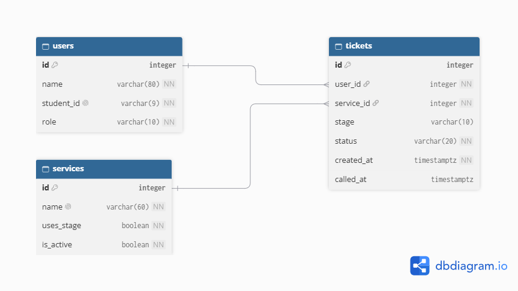

## Nouns in Requirements

| Req ID | Requirement (nouns in bold) | Nouns | Table or column? |
| --- | --- | --- | --- |
| FR-01 | A **customer** can join the **queue** by choosing a **service** and entering their **name** and **Student ID**, and receive a **ticket number** in under 2 minutes without help. | customer, queue, service, name, Student ID, ticket number | (not a table, no accounts), (not a table), `services`, `tickets.name`, `tickets.student_id`, `tickets.id` (shown as A-001) |
| FR-03 | A **customer** can exit the **queue** before being served, after which the **ticket** no longer appears on the **staff list**. | customer, queue, ticket, staff list | (not a table), (not a table), `tickets` (its `status` changes), (not a table, a query of tickets by status) |
| FR-05 | A **staff member** can call the next **person** and mark them as **served** or **no-show**, and the customer's **My place page** shows the new **status** within 10 seconds. | staff member, person, served, no-show, My place page, status | (not a table yet, staff login comes later), `tickets`, `tickets.status` value, `tickets.status` value, (not a table, a screen), `tickets.status` |
| FR-07 | A **customer** who is still **browsing** at **Buy merch** can tell the **system** they are **ready to pay**, and moves into the **paying group**. | customer, browsing, Buy merch, system, ready to pay, paying group | (not a table), `tickets.stage` value, a row in `services`, (not a table), `tickets.stage` value, `tickets.stage = 'paying'` (a query, not a table) |
| FR-08 | A **student** can join only with a **Student ID** in the **format** 0000-0000; any other ID is refused with a **message** showing the correct format. | student, Student ID, format, message | (not a table), `tickets.student_id`, (a rule, not a column), (not stored) |
| FR-09 | A **staff member** can add, rename and switch off a **service**. | staff member, service | (not a table yet), `services` (add = new row), `services.name` (rename), `services.is_active` (switch off) |
| FR-10 | A **customer** can switch to either Light or Dark **mode**. | customer, mode | (not a table), a theme preference (stored in the browser, not the database) |
| FR-11 | A **customer** whose **ticket** has been called has 3 minutes to reach the **counter**, sees a **countdown** and a **warning** when 1 minute is left, and the ticket is marked **no-show** automatically if the **time** runs out. | customer, ticket, counter, countdown, warning, no-show, time | (not a table), `tickets`, (not a table), (computed: `called_at` + 3 minutes − now), (computed, not stored), `tickets.status` value, `tickets.called_at` (a stored fact) |

## Tables and Columns

| Table | Lang-Q-t columns |
| --- | --- |
| users | id, name, student_id, role |
| services | id, name, uses_stage, is_active |
| tickets | id, user_id, service_id, stage, status, created_at, called_at |

## Types and Constraints

| Table | Column | PostgreSQL type | Constraint | Why |
| --- | --- | --- | --- | --- |
| users | id | integer, generated | PRIMARY KEY | Generated by the database, never reused |
| users | name | varchar(80) | NOT NULL, CHECK (length(trim(name)) > 0) | Every person has a real name, not blank spaces |
| users | student_id | varchar(9) | NOT NULL UNIQUE, CHECK (student_id ~ '^[0-9]{4}-[0-9]{4}$') | One row per student, and only the 0000-0000 format (FR-08) |
| users | role | varchar(10) | NOT NULL DEFAULT 'customer', CHECK (role IN ('customer', 'staff')) | Only two roles exist, and new people are customers |
| services | id | integer, generated | PRIMARY KEY | Generated by the database, never reused |
| services | name | varchar(60) | NOT NULL UNIQUE | Two services cannot share a name |
| services | uses_stage | boolean | NOT NULL DEFAULT false | Says whether the service asks "browsing or ready to pay" (Buy merch does) |
| services | is_active | boolean | NOT NULL DEFAULT true | Switching a service off hides it without deleting its history (FR-09) |
| tickets | id | integer, generated | PRIMARY KEY | Generated by the database, never reused; shown as A-001 |
| tickets | user_id | integer | NOT NULL REFERENCES users(id) | No ticket for a missing person |
| tickets | service_id | integer | NOT NULL REFERENCES services(id) | No ticket for a missing service |
| tickets | stage | varchar(10) | CHECK (stage IN ('browsing', 'paying')) | Only two stages; empty for services that do not use it (FR-06, FR-07) |
| tickets | status | varchar(20) | NOT NULL DEFAULT 'waiting', CHECK (status IN ('waiting', 'called', 'served', 'no-show', 'left')) | Only these five states are allowed, and a new ticket starts as waiting |
| tickets | created_at | timestamptz | NOT NULL DEFAULT now() | Time zone safe; set by the database; decides who is first in line |
| tickets | called_at | timestamptz | CHECK (called_at IS NULL OR called_at >= created_at) | Empty until staff call the ticket; cannot be before the person joined; drives the 3-minute limit (FR-11) |

## Entity Relationship Diagram

> 

## Check if normal

1. **One value per cell (1NF):** does any column hold a list, such as "Haircut, Shave"? **No**
2. **Depends on the whole key (2NF):** in each join table, does every extra column depend on both keys? **No**
3. **No hidden copies (3NF):** would you ever have to update the same fact, such as a person's email or a service's name, in more than one row? **No**

